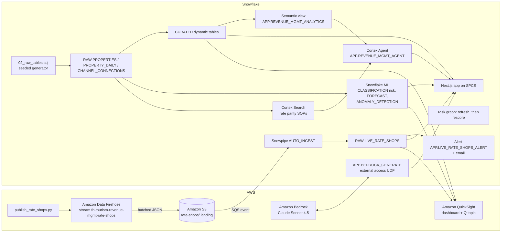

# Thailand Hotel Revenue Management - RevPAR, Rate Parity and Breach Risk

End-to-end revenue management analytics for **40 properties in a fictional Thai hotel group across 5 cities** (Bangkok, Phuket, Chiang Mai, Pattaya, Krabi) using Snowflake, optionally with AWS: from a live competitor rate-shop alert to a 7-day rate parity breach risk score, an alert email and an AI action memo for the revenue management team. All data is synthetic and property-level: there are no guest records, no guest identifiers, and no real hotel, channel or competitor rates.

## Architecture

A revenue management pipeline built on **Snowflake** (Dynamic Tables, Snowflake ML, Cortex Search, Cortex Agent, Cortex AI_COMPLETE, SPCS) and, in the full build, **AWS** (Amazon Data Firehose, S3, Bedrock Claude, QuickSight + Amazon Q). Rate-shop events land in `RAW.LIVE_RATE_SHOPS`. Dynamic tables curate 90 days of property-day history: room occupancy against available rooms, ADR, RevPAR and room revenue, new bookings against budget, bookings sold below the rate floor, rate parity alerts, confirmed parity breaches, channel cases, rate sync lag and rate-loading audit compliance. Snowflake ML scores 7-day parity breach risk per property, forecasts daily new bookings and flags rate sync lag anomalies. A Cortex Agent answers questions with SOP citations, and an LLM drafts the revenue management action memo.

Interactive diagrams (hover for object names): [Snowflake only](docs/architecture-snowflake.html) | [AWS + Snowflake](docs/architecture-aws.html). The app shows both on its Architecture & Data tab, the current build first. Regenerate them with `python3 docs/build_architecture.py`.



The Snowflake-only build drops the AWS subgraph: `APP.SIMULATE_RATE_SHOPS` writes to `RAW.LIVE_RATE_SHOPS`, and the app calls Cortex `AI_COMPLETE` instead of the Bedrock UDF.

## Snowflake Capabilities

| Capability | Implementation |
|-----------|---------------|
| Dynamic Tables | `CURATED.KPI_SUMMARY`, `PERFORMANCE_SUMMARY`, `DRIVER_SUMMARY`, `TREND_ANALYSIS` from the RAW tables |
| Snowflake ML | CLASSIFICATION 7-day rate parity breach risk (`ML.BREACH_RISK_SCORES`), 14-day FORECAST of new bookings, rate sync lag ANOMALY_DETECTION |
| Cortex Search | 14 synthetic rate parity SOPs (one per property type and breach driver) in `SEARCH.PROPERTY_SOP_SEARCH` |
| Semantic View | `APP.REVENUE_MGMT_ANALYTICS` over properties, breach drivers, daily totals and risk |
| Cortex Agent | `APP.REVENUE_MGMT_AGENT`: Cortex Analyst over the semantic view plus Cortex Search for SOP citations |
| Cortex AI | `AI_COMPLETE('claude-sonnet-4-5')` for grounded answers, and for the action memo in the Snowflake-only build |
| Alerts + Tasks | `APP.LIVE_RATE_SHOPS_ALERT` logs ALERT events and sends email; task graph `TASK_REFRESH_CURATED`, then `TASK_RESCORE_RISK` |
| Snowpark Container Services | Next.js app `APP.TH_TOURISM_REVENUE_MGMT_APP` with 6 tabs: Executive Cockpit, Predictive, Parity Risk, Live Rate Shops, Ask AI, Architecture & Data |
| Snowpipe | `RAW.LIVE_RATE_SHOPS_PIPE` AUTO_INGEST from S3 (AWS build only) |

## AWS Services

Used only in the AWS + Snowflake build.

| Service | Role in Demo |
|---------|-------------|
| Amazon Data Firehose | Direct PUT Firehose stream `th-tourism-revenue-mgmt-rate-shops` receives simulated rate-shop events and writes batches to S3 |
| Amazon S3 | Landing bucket (`rate-shops/`). An event notification goes to the Snowpipe SQS queue |
| Amazon Bedrock | Claude Sonnet 4.5 writes the action memo, called from Snowflake through an external-access UDF |
| Amazon QuickSight | DIRECT_QUERY executive dashboard over Snowflake (daily bookings and parity alerts, confirmed parity breaches by property, breach risk) |
| Amazon Q | Natural-language questions over the QuickSight topic `th-tourism-revenue-mgmt-topic` |
| AWS IAM | Least-privilege roles for S3, Firehose and Bedrock |

## Personas

These personas are fictional.

| Persona | Role | Key Questions |
|---------|------|---------------|
| **Kanokwan Srisuk** | Group Director of Revenue Management | "Which cities and property types lead on RevPAR?" "Which breach drivers turn into confirmed rate parity breaches?" |
| **Thanakorn Boonmee** | Distribution Manager | "Which properties are high risk this week, and which SOP applies?" |

## Data

All data is synthetic and seeded, so every rebuild reproduces it. The hotel group, properties and names are fictional. Tables hold property-level daily counts only: there are no guest records or guest identifiers, rates are synthetic and are not real hotel, OTA or competitor prices, and nothing in this demo is pricing, investment or legal advice.

| Table | Rows | Description |
|-------|------|-------------|
| RAW.PROPERTIES | 40 | Properties across 5 Thai cities and 5 property types (City hotel, Beach resort, Pool villa, Boutique, Serviced residence), with available rooms, service tier, rate shops per day, synthetic rack rate and 90-day bookings budget |
| RAW.PROPERTY_DAILY | 3,600 | Daily property performance over 90 days: new bookings and bookings at or above the rate floor, rooms sold against available rooms, room revenue (THB), rate parity alerts, confirmed parity breaches, channel cases, breach driver, rate-loading audits, rate sync lag hours and open rate mismatches |
| RAW.CHANNEL_CONNECTIONS | 40 | Distribution channel mix, channels connected, channels parity-audited and audits pending per property |
| SEARCH.PROPERTY_SOP_DOCS | 14 | Synthetic rate parity SOPs indexed for Cortex Search |
| RAW.LIVE_RATE_SHOPS | Grows during the demo | Live rate-shop events from Firehose (AWS build) or `APP.SIMULATE_RATE_SHOPS` (Snowflake-only build) |
| ML.BREACH_RISK_SCORES | 40 | 7-day rate parity breach probability and risk band per property |

## Build Instructions

### Prerequisites
- Snowflake account with ACCOUNTADMIN access, and Cortex AI enabled (AI_COMPLETE, Search, Agent).
- An X-Small warehouse with auto-suspend at or below 120 s, and an existing SPCS compute pool.
- Python 3.11+, `snowflake-connector-python`, Node.js 22+, Docker and the `snow` CLI.
- App image: run `snow spcs image-registry login`, then build and push `th-tourism-revenue-mgmt-app:v1` to the database's `APP.IMAGES` repository (see the header of `snowflake/07_deploy_app.sql`).
- AWS build only: `boto3`, AWS credentials for the target account (us-west-2) with Bedrock access, and QuickSight Enterprise.

### SPCS App
```
<DATABASE>.APP.TH_TOURISM_REVENUE_MGMT_APP
```

### Tests
```bash
python -m pytest aws snowflake quicksight
```

For a local run, put `SNOWFLAKE_ACCOUNT`, `SNOWFLAKE_USER`, `SNOWFLAKE_DATABASE`, `SNOWFLAKE_WAREHOUSE`, `SNOWFLAKE_AUTHENTICATOR=PROGRAMMATIC_ACCESS_TOKEN`, `SNOWFLAKE_TOKEN` and `DEMO_PLATFORM` in the environment, then run `npm --prefix app run build && npm --prefix app start`.

## Build Modes

Both modes share the same core. They differ in three places, and the app's `DEMO_PLATFORM` setting (in its SPCS spec) switches the memo provider and the Live Rate Shops tab.

| Layer | Snowflake Only | Full AWS + Snowflake |
|---|---|---|
| Live rate shops | `CALL APP.SIMULATE_RATE_SHOPS(n)` inserts simulated rate-shop events into `RAW.LIVE_RATE_SHOPS`. This simulates a rate-shopping service feed; it is not Snowpipe Streaming | `aws/publish_rate_shops.py` to Amazon Data Firehose, then S3, SQS and Snowpipe AUTO_INGEST |
| Action memo | Cortex `AI_COMPLETE('claude-sonnet-4-5')` | Amazon Bedrock Claude Sonnet 4.5 through `APP.BEDROCK_GENERATE` |
| BI and natural-language questions | The SPCS app is the dashboard; questions go to the Cortex Agent | Also a QuickSight dashboard and an Amazon Q topic |
| App setting | `DEMO_PLATFORM: snowflake` | `DEMO_PLATFORM: aws` |

### Snowflake Only

```bash
# 1. Core data and dynamic tables (guarded: new isolated database only)
python snowflake/run_core.py --database THAILAND_TOURISM_REVENUE_MGMT_SNOWFLAKE --warehouse <XS_WAREHOUSE> --connection <CONNECTION> --apply
# 2. Native rate-shop feed, ML, search, semantic view, agent, alert and task graph
python snowflake/run_intelligence.py --database THAILAND_TOURISM_REVENUE_MGMT_SNOWFLAKE --platform snowflake --warehouse <XS_WAREHOUSE> --connection <CONNECTION> --alert-email you@example.com
# 3. App on SPCS with DEMO_PLATFORM=snowflake (push the image first)
python snowflake/run_intelligence.py --database THAILAND_TOURISM_REVENUE_MGMT_SNOWFLAKE --platform snowflake --warehouse <XS_WAREHOUSE> --connection <CONNECTION> --alert-email you@example.com --files 07_deploy_app.sql --compute-pool <COMPUTE_POOL>
```

During the demo:
- Run `CALL APP.SIMULATE_RATE_SHOPS(20)` to add live rate-shop events. For a continuous feed, run `ALTER TASK APP.TASK_SIMULATE_RATE_SHOPS RESUME`, and `SUSPEND` it afterwards.
- Run `EXECUTE ALERT APP.LIVE_RATE_SHOPS_ALERT` to raise the alert email.
- Run `EXECUTE TASK APP.TASK_REFRESH_CURATED` to refresh the curated tables and rescore risk.

Afterwards, drop the database or run `ALTER SERVICE APP.TH_TOURISM_REVENUE_MGMT_APP SUSPEND`.

### Full AWS + Snowflake

```bash
# 1. Core data and dynamic tables (guarded: new isolated database only)
python snowflake/run_core.py --database THAILAND_TOURISM_REVENUE_MGMT_AWS --warehouse <XS_WAREHOUSE> --connection <CONNECTION> --apply
# 2. AWS ingestion and Bedrock (dry run first, then --apply)
python aws/setup_aws.py --database THAILAND_TOURISM_REVENUE_MGMT_AWS --account <AWS_ACCOUNT_ID> --connection <CONNECTION> --apply
# 3. ML, search, semantic view, agent, alert and task graph
python snowflake/run_intelligence.py --database THAILAND_TOURISM_REVENUE_MGMT_AWS --platform aws --warehouse <XS_WAREHOUSE> --connection <CONNECTION> --alert-email you@example.com
# 4. App on SPCS with DEMO_PLATFORM=aws (push the image first)
python snowflake/run_intelligence.py --database THAILAND_TOURISM_REVENUE_MGMT_AWS --platform aws --warehouse <XS_WAREHOUSE> --connection <CONNECTION> --alert-email you@example.com --files 07_deploy_app.sql --compute-pool <COMPUTE_POOL>
# 5. QuickSight dashboard and Q topic (needs an existing Snowflake data source)
python quicksight/build_dashboards.py --database THAILAND_TOURISM_REVENUE_MGMT_AWS --account <AWS_ACCOUNT_ID> --principal-arn <QUICKSIGHT_USER_ARN> --data-source-arn <DATA_SOURCE_ARN> --prefix th-tourism-revenue-mgmt --apply --update --with-topic
```

QuickSight objects must be shared with the QuickSight user who signs in (`--principal-arn`); otherwise the console shows nothing.

During the demo:
- Run `python aws/publish_rate_shops.py --count 20` to send live rate-shop events. Firehose buffers for up to 60 seconds before writing to S3.
- Run `EXECUTE ALERT APP.LIVE_RATE_SHOPS_ALERT` to raise the alert email.
- Run `EXECUTE TASK APP.TASK_REFRESH_CURATED` to refresh the curated tables and rescore risk.

Afterwards, `python aws/teardown_aws.py --database THAILAND_TOURISM_REVENUE_MGMT_AWS --account <AWS_ACCOUNT_ID> --connection <CONNECTION> --apply` removes the AWS resources and the account-level Bedrock external-access and S3 storage integrations. It leaves the email integration `TH_TOURISM_REVENUE_MGMT_EMAIL_INT`, which the Snowflake-only build also uses.

## Business Impact

Snowflake customer outcomes:
- **Accor** (Snowflake customer), a hospitality group with over 5,700 hotels, built a customer data platform on Snowflake and Hightouch: "a request to the data team isolating a specific segment ready for a campaign used to take three weeks — now the marketing teams can do it directly themselves in just a few days." -- [Snowflake customer story: Accor](https://www.snowflake.com/en/customers/all-customers/case-study/accor/)

## Key Demo Numbers

These figures are synthetic and come from the seeded demo data. Forecast and anomaly figures can shift slightly with the build day.

- **40 properties** with **5,894 available rooms**, 3,600 property-days over 90 days, across 5 Thai cities and 5 property types
- **RevPAR 3,551 THB** and **ADR 4,424 THB** on **room occupancy of 80.3%**; Phuket leads RevPAR at 4,075 THB and Chiang Mai trails at 2,674 THB
- **Room revenue 1,883.8 M THB** over 90 days; **118,958 bookings**, **97.5% of budget**; 8 properties are below 95% of budget
- **19.8% of bookings sold below the rate floor**; average rate sync lag **2.8 hours**; 7,519 open rate mismatches at day end in total
- **510 rate parity alerts** raised and **154 confirmed** as parity breaches, a 30.2% alert confirmation rate; **51 channel cases** opened
- **Wholesale rate leakage** produces the most confirmed breaches (51 of 144 alerts); the 16 channel manager outage alerts are never confirmed
- **Breach risk model** out-of-time holdout (600 property-days): precision 0.48, recall 0.34 at a 0.5 threshold, against a 0.21 base rate. Eight properties are high risk; the top one is HTL-0019, at 97.5%
- **14-day forecast** of 1,351 to 1,411 new bookings per day, with prediction intervals; **58 of 640** property-days flagged as rate sync lag anomalies
- **Rate-loading audit compliance 76.0%**, channel parity audit coverage 61.2%, with 23 channel audits pending
- **14 SOPs** indexed for Cortex Search and cited by ID in agent answers

## License

Apache 2.0 — See [LICENSE](LICENSE) for details.

This is a personal demo project and is not an official Snowflake offering. It comes with no support or warranty. It uses synthetic data only and provides no pricing, investment, legal or contractual advice. The hotel group, properties, channels and personas are fictional. The Snowflake customer story cited above is a reported outcome and not a guarantee of results.

